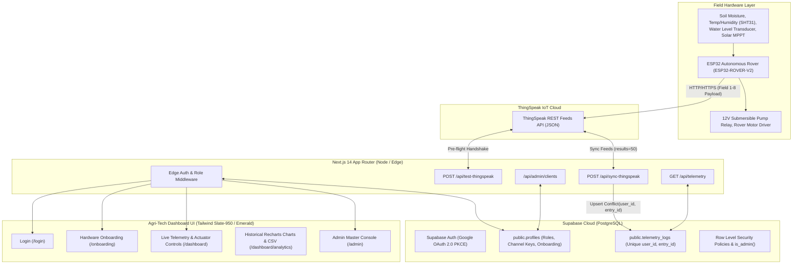
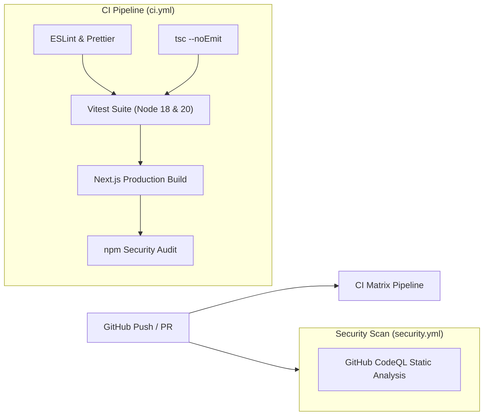

# 🌱 Smart Farm Bot IoT Dashboard

> **Enterprise Precision Agriculture & Autonomous Robotic Fleet Management Platform**  
> Built with **Next.js 14 (App Router)**, **TypeScript**, **Tailwind CSS**, **Recharts**, **Supabase (SSR Auth, Database, RLS)**, and **ThingSpeak REST API Ingestion**.

[](https://nextjs.org/)
[](https://www.typescriptlang.org/)
[](https://tailwindcss.com/)
[](https://supabase.com/)
[](https://thingspeak.com/)
[](.github/workflows/ci.yml)
[](tests/)
[](SECURITY.md)
[](LICENSE)

---

## 📋 Table of Contents
- [System Architecture](#-system-architecture)
- [IoT Telemetry Ingestion (Field 1–8 Mapping)](#-iot-telemetry-ingestion-field-18-mapping)
- [Core Features](#-core-features)
- [Tech Stack](#-tech-stack)
- [Project Structure](#-project-structure)
- [Database Schema & RLS (`supabase_schema.sql`)](#-database-schema--rls-supabase_schemasql)
- [Getting Started](#-getting-started)
  - [Prerequisites](#prerequisites)
  - [Installation](#installation)
  - [Environment Variables](#environment-variables)
  - [Supabase Setup](#supabase-setup)
  - [Development Server](#development-server)
  - [Production Build](#production-build)
- [Automated Testing & Linters](#-automated-testing--linters)
- [CI/CD Pipeline (GitHub Actions)](#-cicd-pipeline-github-actions)
- [Security Policies & Hardening](#-security-policies--hardening)
- [API Reference](#-api-reference)
- [Sandbox & Instant Demo Mode](#-sandbox--instant-demo-mode)
- [Deployment](#-deployment)
- [License](#-license)

---

## 🏗 System Architecture



---

## 📡 IoT Telemetry Ingestion (Field 1–8 Mapping)

Each autonomous rover packages sensor readings into standard ThingSpeak 8-channel payloads:

| ThingSpeak Field | Database Column | Data Type | Units / Range | Hardware Sensor / Actuator |
| :--- | :--- | :--- | :--- | :--- |
| **Field 1** | `soil_moisture` | `NUMERIC(5,2)` | `0.0% – 100.0%` | Capacitive Soil Moisture Probe (Zone A) |
| **Field 2** | `ambient_temp` | `NUMERIC(5,2)` | `-20.0°C – 80.0°C` | SHT31 High-Precision Thermistor |
| **Field 3** | `humidity` | `NUMERIC(5,2)` | `0.0% – 100.0%` | Canopy Microclimate Relative Hygrometer |
| **Field 4** | `water_level` | `NUMERIC(5,2)` | `0.0% – 100.0%` | Ultrasonic Tank Fluid Transducer |
| **Field 5** | `battery_level` | `NUMERIC(5,2)` | `0.0% – 100.0%` | 12.8V 24Ah LiFePO4 BMS State of Charge |
| **Field 6** | `solar_voltage` | `NUMERIC(5,2)` | `0.0V – 30.0V` | 50W Monocrystalline PV MPPT Bus Voltage |
| **Field 7** | `pump_status` | `BOOLEAN` | `true (ON) / false (OFF)` | 12V 2.5A Submersible Irrigation Solenoid |
| **Field 8** | `bot_status` | `TEXT` | `ACTIVE, IRRIGATING, PATROLLING, STANDBY` | Autonomous State Machine & Pathfinder |

---

## ✨ Core Features

### 1. Dark Agri-Tech Design System
- Tuned for high contrast in agricultural control rooms and outdoor field tablets.
- **Slate-950** deep space background (`#020617`, `#090e1c`) with glowing **emerald accents** (`#10b981`, `#34d399`), cyan fluid indicators, and amber solar highlights.
- Glassmorphic panels (`backdrop-blur-md`), subtle glowing borders, and animated status beacons.

### 2. Live Telemetry & Hardware Control Console (`/dashboard`)
- **Radial SVG Arc Gauges**: Soil Moisture (%), Water Reservoir Level (%), and LiFePO4 Battery (%).
- **Environmental & Solar Metrics**: Ambient Temperature (°C), Air Humidity (%), and MPPT Array Voltage (V).
- **Automated Threshold Warnings**: Dynamic banner notifications for root water stress (<45%) or reservoir depletion (<20%).
- **Actuator Override Panel**:
  - Direct toggle control for the pressurized drip irrigation pump.
  - State machine mode selector (`ACTIVE`, `IRRIGATING`, `PATROLLING`, `STANDBY`).
  - Monocrystalline solar absorption telemetry.
- **ThingSpeak Synchronization Trigger**: On-demand sync button with spinner animation and timestamp tracking.

### 3. Historical Climate & Power Analytics (`/dashboard/analytics`)
- **Dynamic Recharts Data Visualizations**:
  - **Dual-Axis Area Chart**: Soil Moisture vs. Ambient Temperature over time.
  - **Canopy Humidity Trend Area Chart**: Microclimate vapor deficit index.
  - **Composed Power Chart**: LiFePO4 Battery capacity combined with Solar Generation bars.
- **Time Range Filters**: Instantly switch between `24H`, `7D`, and `30D` windows.
- **One-Click CSV Export**: Downloads time-series data with timestamp, entry ID, and all 8 telemetry parameters.

### 4. Interactive Onboarding & Live Pre-Flight Handshake (`/onboarding`)
- Form to pair ThingSpeak Channel ID and optional Read API Key.
- **Live Pre-Flight Test**: Dispatches a live HTTP request to the ThingSpeak REST API before saving, validating channel existence and returning channel metadata.
- Pre-loaded **"Use Demo Bot"** button using live public feeds for zero-configuration testing.

### 5. Admin Master Console (`/admin`)
- Accessible strictly by users with `role === 'admin'`.
- **Fleet Aggregate Metrics**: Total registered rovers, active irrigation pumps, and average fleet battery health.
- **Searchable Client Roster**: Filter by operator name, email, or Channel ID.
- **Security Key Masking**: Channel Read API Keys are masked by default with a toggleable eye icon.
- **Inline Editing**: Live PATCH update of Channel IDs, Read Keys, and roles without leaving the table.
- **Cascading Client Purge**: Confirmation modal that deletes client profiles and cascades to permanently clean all telemetry records.

---

## 💻 Tech Stack

| Layer | Technology | Description |
| :--- | :--- | :--- |
| **Framework** | [Next.js 14+ (App Router)](https://nextjs.org/) | Server Actions, Route Handlers, SSR & React 18 |
| **Language** | [TypeScript](https://www.typescriptlang.org/) | Strict typing with custom Database & ThingSpeak interfaces |
| **Styling** | [Tailwind CSS](https://tailwindcss.com/) | Custom Agri-Tech palette, glassmorphism, glow utilities |
| **Icons** | [Lucide React](https://lucide.dev/) | Clean, accessible vector icons |
| **Charting** | [Recharts](https://recharts.org/) | Dynamic Area, Line, Bar, and Composed SVG visualizations |
| **Database & Auth** | [Supabase](https://supabase.com/) | PostgreSQL, `@supabase/ssr`, RLS policies, OAuth 2.0 PKCE |
| **IoT Ingestion** | [ThingSpeak REST API](https://thingspeak.com/) | Real-time IoT channel telemetry feeds ingestion |

---

## 📁 Project Structure

```
smart-farm-bot-dashboard/
├── supabase_schema.sql               # Production database DDL, triggers, and RLS policies
├── package.json                      # Project dependencies & build scripts
├── tsconfig.json                     # Strict TypeScript compiler options (@/* alias)
├── tailwind.config.ts                # Dark Agri-Tech palette & glow effects
├── postcss.config.js                 # Tailwind / Autoprefixer PostCSS config
├── next.config.mjs                   # Next.js configuration
├── .env.local.example                # Example environment variables
├── .env.local                        # Local development environment configuration
│
└── src/
    ├── middleware.ts                 # Next.js Edge route guard & session updater
    │
    ├── app/
    │   ├── layout.tsx                # HTML shell, fonts, dark theme & metadata
    │   ├── globals.css               # Tailwind directives, glassmorphic utilities
    │   ├── page.tsx                  # Home landing hero & live metrics preview
    │   ├── login/
    │   │   └── page.tsx              # Google OAuth 2.0 login & sandbox mode
    │   ├── onboarding/
    │   │   └── page.tsx              # ThingSpeak pre-flight handshake wizard
    │   ├── dashboard/
    │   │   ├── layout.tsx            # Dashboard sidebar, rover beacon, sync button
    │   │   ├── page.tsx              # Client Live Telemetry & Actuator controls
    │   │   └── analytics/
    │   │       └── page.tsx          # Historical Recharts charts & CSV export
    │   ├── admin/
    │   │   └── page.tsx              # Admin Master Console & client roster
    │   ├── auth/
    │   │   ├── callback/route.ts     # OAuth PKCE exchange & redirect handler
    │   │   └── signout/route.ts      # Sign-out route handler
    │   └── api/
    │       ├── sync-thingspeak/route.ts # ThingSpeak fetch & telemetry upsert
    │       ├── test-thingspeak/route.ts # Live ThingSpeak credentials tester
    │       ├── telemetry/route.ts       # Time-series telemetry API with range filters
    │       └── admin/clients/route.ts   # Client roster, PATCH inline edit, DELETE cascade
    │
    ├── components/
    │   ├── dashboard/
    │   │   ├── Sidebar.tsx           # Navigation sidebar, rover beacon, sign out
    │   │   ├── TopNav.tsx            # Header bar with battery, bot state, quick sync
    │   │   └── SyncButton.tsx        # ThingSpeak sync trigger with spinner
    │   ├── ui/
    │   │   ├── GaugeCard.tsx         # Radial SVG progress gauge
    │   │   ├── StatCard.tsx          # Telemetry metric card with trend icons
    │   │   └── ActuatorToggle.tsx    # Pump relay, bot state machine, solar charger
    │   └── charts/
    │       ├── SoilMoistureTempChart.tsx # Soil Moisture vs Temperature Area chart
    │       ├── HumidityChart.tsx         # Relative Humidity trend Area chart
    │       └── PowerSolarChart.tsx       # LiFePO4 Battery vs Solar Voltage chart
    │
    └── lib/
        ├── supabase/
        │   ├── client.ts             # Browser Supabase client
        │   ├── server.ts             # Server Supabase client (cookies)
        │   └── middleware.ts         # Middleware auth & role validation logic
        ├── types/
        │   └── database.types.ts     # Profile, TelemetryLog, ThingSpeak types
        └── utils.ts                  # cn, formatting, and date helpers
```

---

## 🗄 Database Schema & RLS (`supabase_schema.sql`)

The repository includes a complete, production-ready SQL migration in [supabase_schema.sql](file:///home/nil/Documents/Antigravity%20projects/supabase_schema.sql).

### Key Entities
1. **`public.profiles`**:
   - `id UUID PRIMARY KEY REFERENCES auth.users(id) ON DELETE CASCADE`
   - `email TEXT NOT NULL`
   - `full_name TEXT`
   - `avatar_url TEXT`
   - `role TEXT CHECK (role IN ('client', 'admin')) DEFAULT 'client'`
   - `thingspeak_channel_id TEXT`
   - `thingspeak_read_key TEXT`
   - `is_onboarded BOOLEAN DEFAULT FALSE`
   - `created_at`, `updated_at TIMESTAMPTZ`

2. **`public.telemetry_logs`**:
   - `id BIGSERIAL PRIMARY KEY`
   - `user_id UUID NOT NULL REFERENCES public.profiles(id) ON DELETE CASCADE`
   - `entry_id BIGINT NOT NULL`
   - `soil_moisture NUMERIC(5,2)` (Field 1)
   - `ambient_temp NUMERIC(5,2)` (Field 2)
   - `humidity NUMERIC(5,2)` (Field 3)
   - `water_level NUMERIC(5,2)` (Field 4)
   - `battery_level NUMERIC(5,2)` (Field 5)
   - `solar_voltage` `NUMERIC(5,2)` (Field 6)
   - `pump_status BOOLEAN DEFAULT FALSE` (Field 7)
   - `bot_status TEXT DEFAULT 'ACTIVE'` (Field 8)
   - `recorded_at TIMESTAMPTZ NOT NULL`
   - **Constraint**: `UNIQUE (user_id, entry_id)` for idempotent upserts.

3. **Security & RLS**:
   - Helper function `public.is_admin()` checks admin status with `SECURITY DEFINER`.
   - **Profiles**: Clients can read/update their own profile. Admins can read, update, and delete all profiles.
   - **Telemetry Logs**: Clients can read and insert their own telemetry. Admins can read, insert, and delete all telemetry records.

---

## 🚀 Getting Started

### Prerequisites
- **Node.js**: v18.17+ or v20+ (Node.js 20 LTS recommended)
- **npm**: v9+ (or pnpm / yarn)

### Installation

```bash
# Clone the repository
git clone https://github.com/your-username/smart-farm-bot-dashboard.git
cd smart-farm-bot-dashboard

# Install dependencies
npm install
```

### Environment Variables

Copy the example environment template and configure your credentials:

```bash
cp .env.local.example .env.local
```

Edit `.env.local`:
```env
# Supabase Project URL and Anon Public Key
NEXT_PUBLIC_SUPABASE_URL=https://your-project.supabase.co
NEXT_PUBLIC_SUPABASE_ANON_KEY=your-supabase-anon-key

# Optional: Supabase Service Role Key (for administrative operations)
SUPABASE_SERVICE_ROLE_KEY=your-supabase-service-role-key

# Public App Base URL
NEXT_PUBLIC_APP_URL=http://localhost:3000
```

### Supabase Setup
1. Log in to your [Supabase Dashboard](https://supabase.com/dashboard).
2. Open the **SQL Editor** in your Supabase project.
3. Paste and run the entire contents of [supabase_schema.sql](file:///home/nil/Documents/Antigravity%20projects/supabase_schema.sql).
4. Under **Authentication &rarr; Providers**, enable **Google** and configure your Google Cloud OAuth Client ID and Secret with the callback URL:
   ```
   https://<your-project-ref>.supabase.co/auth/v1/callback
   ```

### Development Server

```bash
npm run dev
```

Open [http://localhost:3000](http://localhost:3000) in your browser.

### Production Build

```bash
# Build production bundle
npm run build

# Start production server
npm start
```

---

## 🧪 Automated Testing & Linters

The project includes automated unit, integration, and UI component tests powered by **Vitest** and **React Testing Library**:

```bash
# Run full automated test suite (27 passing tests)
npm run test

# Run tests in watch mode during development
npm run test:watch

# Type check all TypeScript source files without emitting
npm run type-check

# Run ESLint validation
npm run lint

# Check code formatting with Prettier
npm run format:check

# Auto-format all source files
npm run format
```

### Test Coverage Highlights
- **Unit Tests (`tests/unit/utils.test.ts`)**: Validates class merging (`cn`), numeric decimal precision formatting (`formatNumber`), ISO timestamps (`formatDate`), and dynamic relative time calculations (`formatRelativeTime`).
- **ThingSpeak Parsers (`tests/unit/thingspeak-parser.test.ts`)**: Validates 8-field telemetry ingestion, numeric conversion, boolean pump states (`1`, `true`, `on`, `active`, `0`, `off`), and bot operational state machine normalization (`ACTIVE`, `IRRIGATING`, `PATROLLING`, `STANDBY`).
- **UI Component Tests (`tests/components/`)**:
  - `StatCard.test.tsx`: Validates rendering, unit indicators, and dynamic trend badges.
  - `GaugeCard.test.tsx`: Validates SVG circular arc calculations, clamped limits, and threshold labels.
  - `ActuatorPanel.test.tsx`: Validates pump solenoid override buttons, state machine buttons, and callback dispatches.

---

## ⚙️ CI/CD Pipeline (GitHub Actions)

Continuous Integration and Security Scans run automatically on every `push` and `pull_request` to `main` / `master` via [`.github/workflows/ci.yml`](file:///.github/workflows/ci.yml) and [`.github/workflows/security.yml`](file:///.github/workflows/security.yml):



### GitHub Actions Jobs:
1. **`lint-and-typecheck`**: Enforces zero ESLint warnings, verifies code style, and validates TypeScript compilation.
2. **`unit-and-integration-tests`**: Runs the 27-test Vitest suite across a Node.js matrix (`18.x`, `20.x`).
3. **`build-verification`**: Executes `next build` to verify all 15 static and dynamic App Router routes compile.
4. **`security-audit`**: Checks dependencies against known CVE databases with `npm audit`.
5. **`codeql`**: Automated weekly and PR code scanning for static vulnerability detection.

---

## 🛡 Security Policies & Hardening

See [`SECURITY.md`](file:///SECURITY.md) for full vulnerability disclosure guidelines and hardware safety procedures.

### Security Highlights:
- **Zero-Knowledge API Key Storage**: ThingSpeak Read API Keys are encrypted in Supabase and masked in the browser UI (`••••••••••••` with toggleable reveal).
- **Supabase Row Level Security**: Strictly isolates telemetry data by `auth.uid() = user_id`. Admins are validated through a secure `public.is_admin()` helper.
- **Edge Route Guards**: Next.js Middleware acts as an unbypassable security barrier, redirecting unauthorized traffic before hitting server actions or database queries.
- **HTTP Security Headers**: Enforces HSTS (`max-age=63072000`), `X-Frame-Options: SAMEORIGIN`, `X-Content-Type-Options: nosniff`, and restrictive `Permissions-Policy`.
- **Relay Actuator Validation**: All hardware control commands are authenticated and sanitized against known state machine enums.

---

## 🔌 API Reference

### 1. Synchronize ThingSpeak Telemetry
- **Endpoint**: `POST /api/sync-thingspeak`
- **Description**: Ingests feeds from ThingSpeak and upserts them into `public.telemetry_logs`.
- **Request Body** *(Optional, falls back to user profile)*:
  ```json
  {
    "channel_id": "12397",
    "read_key": "YOUR_OPTIONAL_READ_KEY"
  }
  ```
- **Response**:
  ```json
  {
    "success": true,
    "channel": "WeatherStation",
    "count": 50,
    "latest": { ... },
    "message": "Successfully synchronized 50 telemetry feeds."
  }
  ```

### 2. Live Pre-Flight Credentials Check
- **Endpoint**: `POST /api/test-thingspeak`
- **Description**: Verifies Channel ID and Read API Key with the ThingSpeak REST API without saving.
- **Request Body**:
  ```json
  {
    "channel_id": "12397",
    "read_key": ""
  }
  ```
- **Response**:
  ```json
  {
    "valid": true,
    "channel": {
      "id": 12397,
      "name": "WeatherStation",
      "description": "MathWorks Weather Station",
      "fields": {
        "field1": "Soil Moisture (%)",
        "field2": "Ambient Temp (°C)", ...
      }
    }
  }
  ```

### 3. Fetch Time-Series Telemetry
- **Endpoint**: `GET /api/telemetry?range=24h&limit=50`
- **Query Parameters**:
  - `range`: `'24h' | '7d' | '30d' | 'all'` (default: `'24h'`)
  - `limit`: `1 - 500` (default: `50`)
  - `user_id`: *(Admin only)* Inspect specific client telemetry
- **Response**:
  ```json
  {
    "success": true,
    "count": 30,
    "logs": [ ... ],
    "latest": { ... },
    "source": "database"
  }
  ```

### 4. Admin Client Operations
- **`GET /api/admin/clients`**: Returns fleet statistics and client roster.
- **`PATCH /api/admin/clients`**: Inline update of client parameters:
  ```json
  {
    "id": "usr_uuid",
    "thingspeak_channel_id": "2418902",
    "thingspeak_read_key": "A8B9C0D1E2F3G4H5",
    "role": "client"
  }
  ```
- **`DELETE /api/admin/clients?id={client_id}`**: Permanently deletes a client and cascades to all telemetry records.

---

## 🧪 Sandbox & Instant Demo Mode

To evaluate the application immediately without physical hardware or OAuth configuration:

1. Navigate to `/login`.
2. Click **"Client Demo"** to access the live telemetry console as an operator.
3. Click **"Admin Console"** to evaluate the fleet manager view with full client management and deletion modals.
4. On `/onboarding`, click **"Use Demo Bot"** to connect to live public telemetry (MathWorks station channel `12397`).

---

## 🚢 Deployment

### Deploying on Vercel
1. Push your code to GitHub.
2. Import the repository in [Vercel](https://vercel.com/).
3. Add the environment variables:
   - `NEXT_PUBLIC_SUPABASE_URL`
   - `NEXT_PUBLIC_SUPABASE_ANON_KEY`
   - `NEXT_PUBLIC_APP_URL` (your production URL)
4. Deploy! Next.js will build and optimize all static and dynamic routes.

---

## 📄 License

This project is licensed under the **MIT License** — see the [LICENSE](LICENSE) file for details.
